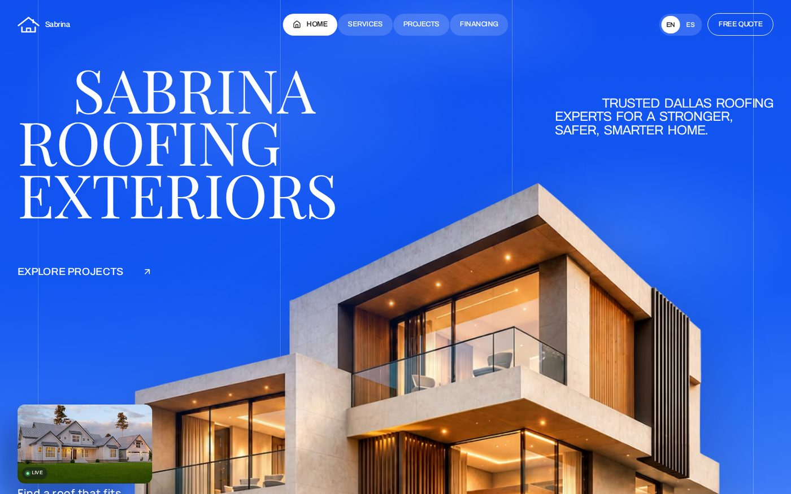
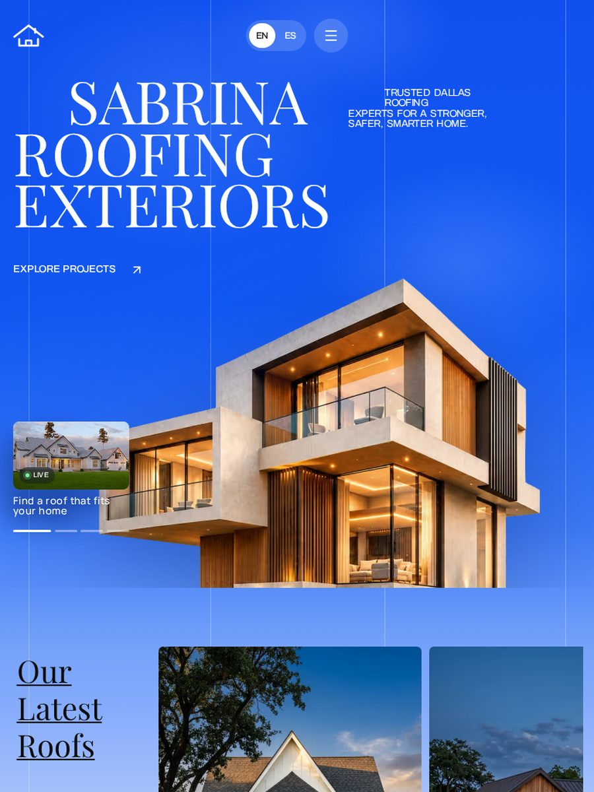
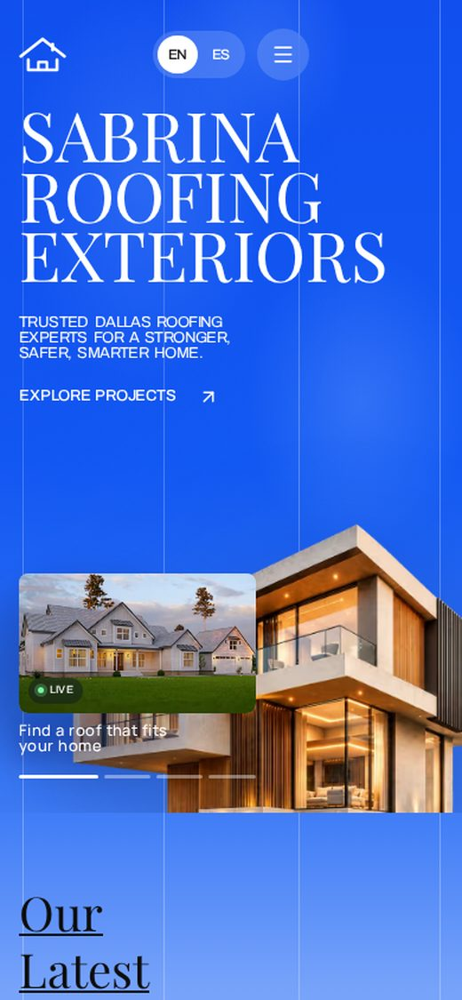

# Sabrina Roofing & Exteriors — Dallas

A responsive, motion-led landing page for a Dallas roofing contractor, built with **Next.js 15 (App Router)**, **Tailwind CSS v4** and hand-tuned CSS. Every element animates in step by step, word by word, on load; the portfolio section animates on scroll.

> The brief was a real-estate layout ("Sabrina Residences"). It has been re-skinned end-to-end for **Sabrina Roofing & Exteriors**: the headline, tagline, nav, CTA, portfolio, services, footer, SEO and structured data are all roofing content. The layout system, typography scale, motion timings and gradient background from the brief are implemented as specified.

---

## Preview

| Desktop | Tablet | Mobile |
|---|---|---|
|  |  |  |

Full-page capture: [`preview/desktop-full.jpg`](preview/desktop-full.jpg) · mobile menu: [`preview/mobile-menu.jpg`](preview/mobile-menu.jpg)

---

## Quick start

```bash
npm install
npm run dev      # http://localhost:3000
npm run build && npm start   # production
```

No environment variables, no external services, no API keys. The page is fully static (SSG) and makes **zero third-party network requests**.

---

## Project structure

```
app/
  layout.tsx        fonts, metadata, JSON-LD (RoofingContractor), theme colour
  page.tsx          page composition (gradient shell → hero → gallery → services → footer)
  globals.css       design tokens, all animation keyframes, component styles, breakpoints
  icon.svg          favicon / brand mark
  robots.ts         /robots.txt
  sitemap.ts        /sitemap.xml
components/
  word-reveal.tsx   the word-by-word animation engine (stagger, blur, pin-after-settle)
  site-header.tsx   pill nav, EN/ES switch, mobile drawer (Esc / outside-click / resize aware)
  hero.tsx          headline, tagline, explore link, house image
  video-card.tsx    self-healing autoplay video + 4-part progress bars
  latest-roofs.tsx  "Our Latest Roofs" gallery (IntersectionObserver reveal)
  services.tsx      four service cards
  site-footer.tsx   contact, hours, financing, legal
  locale-context.tsx  EN/ES state
  roof-mark.tsx     inline SVG logo
lib/
  content.ts        ← ALL demo copy and data (EN + ES) lives here
  use-in-view.ts    in-view hook ("load" or "scroll" trigger)
public/
  images/           hero + project photos (WebP, pre-sized)
  media/            hero video (WebM + MP4) + poster
  fonts/            Playfair Display, Archivo, Manrope — latin subset, self-hosted
scripts/
  optimize-images.mjs    builds the WebP project images from source art
  screenshots.mjs        Playwright captures at 8 viewports
  interaction-tests.mjs  menu, language switch, keyboard order, seek, reduced motion
  audit-a11y.mjs         axe-core audit (desktop + mobile)
preview/            reference screenshots
```

### Editing the demo content

Everything a client would change is in **`lib/content.ts`**:

- `brand` — phone, email, address, city, founding year (feeds the footer, JSON-LD and metadata).
- `copy.en` / `copy.es` — headline, tagline, nav labels, CTA, video caption, project cards, services, footer. Adding a language means adding one object here; the switch is generated from `locales`.

---

## Motion spec → implementation

| Brief | Implementation |
|---|---|
| 4 grid lines grow from top | `@keyframes lineGrow`, `scaleY 0→1`, 1.6s `cubic-bezier(.65,0,.35,1)`, delays 0/.1/.2/.3s |
| Hero house parallax rise | `@keyframes heroRise`, `translateY(70%) scale(1.06) → 1`, 4.2s `cubic-bezier(.22,.61,.24,1)`, delay .2s |
| Nav fades down | `@keyframes navDown`, 0.8s, staggered 100→650ms via `--nav-delay` |
| Word-by-word text | `word-reveal.tsx` + `@keyframes wordIn` (opacity 0, `translateY(.45em)`, `blur(10px)`) — H1 550/750/950ms, tagline 1150ms +60ms/word, explore 1850ms, caption 2150ms +60ms/word |
| Video card + bars | `cardIn` (1s, delay 2s), `barGrow` (`scaleX`, .9s, delay 2.55s) |
| Scroll reveal for gallery | `IntersectionObserver` @ 0.15 → heading words 0/.15/.3s, cards .2/.35/.5s |
| Video never stops | replays on `pause`-state check every 1s, `ended`, `stalled`, `suspend`, tab visibility change, and the first user gesture |

**Deliberate refinements** (all reversible):

- Hero image opacity reaches 1 at 8% of its animation instead of 25%, so the largest image can paint as LCP while still doing the full 4.2s rise.
- Words are pinned visible once their cascade finishes, so switching language doesn't replay the hero.
- Tagline gets `word-spacing: .18em` — at `letter-spacing: -.045em` the words visually merge.
- Hover/focus states and `:focus-visible` rings added throughout; icon-only controls have `aria-label`s.

---

## Responsive behaviour

`clamp()` drives every size, so type and spacing scale continuously rather than snapping.

| Width | Layout |
|---|---|
| > 860px | Full pill nav; headline left, tagline right; 3-up gallery |
| ≤ 860px | Nav replaced by hamburger + glass dropdown; tagline stacks under the headline; gallery becomes a snap-scrolling row (keyboard accessible) |
| ≤ 640px | Hero re-composed: whole house anchored to the hero floor, video card overlays it; single-column services/footer |

Verified at 360, 390, 768, 834, 1024, 1280 and 1440px: **0px horizontal overflow at every width**.

---

## Accessibility

- **axe-core: 0 violations** (WCAG 2.0/2.1 A + AA + best-practice) on desktop and mobile.
- Semantic landmarks, one `h1`, ordered headings, skip link, `aria-current` on the active nav item.
- Keyboard: visible focus rings, drawer closes on Escape and outside click, gallery row focusable/arrow-scrollable, 24×24px minimum target size on the video progress bars.
- `prefers-reduced-motion: reduce` disables all animation and pins every element visible.
- `noscript` fallback keeps all text visible without JavaScript.
- Assistive-tech friendly word splitting: forced line breaks emit real spaces, so the headline reads "SABRINA ROOFING EXTERIORS", not one glued word.
- Bilingual: `<html lang>` follows the language switch.

---

## Performance

Measured with Lighthouse 12 (mobile emulation, headless Chromium, local production build — a shared 2-vCPU sandbox, so real-world numbers on a CDN will be better):

| Category | Score |
|---|---|
| Performance | **92** |
| Accessibility | **100** |
| Best Practices | **100** |
| SEO | **100** |

FCP 0.9s · **LCP 3.1s** · TBT 160ms · **CLS 0** · TTI 3.3s · total page weight **584 KB**.

Optimizations applied (see `AUDIT-REPORT.md` for the before/after):

1. Self-hosted, latin-subset fonts with `font-display: swap` and metric-matched fallbacks — no Google Fonts request, no CLS.
2. Images pre-sized to the widths actually used, served as WebP/AVIF through `next/image`; limited `deviceSizes` so no oversized variant wins the `srcset`.
3. Hero image `priority` + `fetchpriority="high"`, everything below the fold lazy-loaded with intrinsic `width`/`height` (CLS 0).
4. Hero video delayed until page `load`, `preload="none"`, WebM (VP9) + MP4 (H.264) + poster — no bandwidth competition with the LCP image, and playback survives browsers without H.264.
5. Motion is pure CSS keyframes/transforms (GPU-composited) — no animation library in the bundle.
6. First Load JS 116 KB total for the route (React + Next runtime + lucide icons), fully static HTML.

---

## SEO

- Title/description, Open Graph + Twitter cards, canonical base URL.
- `RoofingContractor` JSON-LD: address, geo, phone, opening hours, services, service area.
- `robots.txt` + `sitemap.xml` generated from the same `brand` config.
- Descriptive `alt` text on every image, one `h1`, descriptive link text.

---

## Notes for handoff

- **Demo data.** Phone `(214) 555-0134`, email, address and the “25-year warranty / 1,200+ roofs / GAF certified” claims are placeholders — replace them in `lib/content.ts` before launch. Footer marks the content as demo.
- **Imagery.** The hero house and the video come from the assets supplied in the brief; the three portfolio photos were generated as roofing-specific stand-ins (the brief's gallery images were interiors). Swap in real job photos in `public/images/`.
- **Set `brand.url`** in `lib/content.ts` to the live domain so canonical/OG/sitemap URLs are correct.
- **Deploy:** Vercel (zero config) or any Node host — `npm run build && npm start`. For fully static hosting, `next build` with `output: "export"` also works if you set `images.unoptimized: true`.
- The dev-only audit scripts need `npx playwright install chromium` before running.

---

## Deploy to Vercel

The repo is deploy-ready: framework is auto-detected as Next.js, `npm run build` runs the font fetch step, and there is nothing to configure besides the optional env var below.

### Option A — import from GitHub (recommended)

1. Push this repo to GitHub (see *Push to a new GitHub repo* below).
2. Go to [vercel.com/new](https://vercel.com/new) → **Import Git Repository** → pick the repo.
3. Framework preset: **Next.js** (auto-detected). Leave build/install commands untouched. **Deploy**.

Every push to `main` then redeploys automatically.

### Option B — Vercel CLI

```bash
npm i -g vercel
vercel          # first run links the project (answer the prompts)
vercel --prod   # production deploy
```

### Optional environment variable

| Name | Value | When |
|---|---|---|
| `NEXT_PUBLIC_REMOTE_ASSETS` | `1` | Only if you want the hero image/video and gallery photos served from remote origins (Vercel's image optimizer still delivers optimized AVIF/WebP). Leave unset to use the self-hosted files in `public/`, which is the exact setup that was audited. |

### Push to a new GitHub repo

```bash
# this folder is already a git repo with one commit on `main`
gh repo create sabrina-roofing --public --source=. --remote=origin --push
# …or without the GitHub CLI:
git remote add origin https://github.com/<you>/sabrina-roofing.git
git push -u origin main
```
